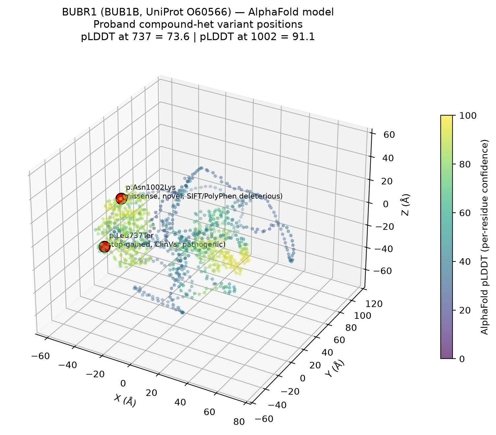

# Track 2 Report — Drug Repurposing — MVA Hackathon 2026

**Team / participant:** IHRH (verify against actual Hugging Face username before submitting)
**Builds on:** Track 1 primary finding — compound heterozygous BUB1B
(chr15:40,209,701 T>G, p.Leu737Ter, ClinVar pathogenic + chr15:40,220,612 T>G,
p.Asn1002Lys, novel deleterious). See
[../reports/track1/IHRH_track1_report.md](../reports/track1/IHRH_track1_report.md).

## 1. Mechanism of disease

BUB1B encodes **BUBR1**, a core kinase of the mitotic spindle-assembly
checkpoint (SAC) — the surveillance system that delays anaphase until every
chromosome is correctly attached to the mitotic spindle. Loss of BUBR1
function is **dosage-dependent**: experimental knockdown studies show that
residual BUBR1 below ~50% is sufficient to cause premature chromatid
separation (PCS), and further reduction produces overt aneuploidy (Bohers et
al. 2008, PMID 18932004; Matsuura et al. 2006, PMID 16411201). This is
consistent with MVA1 typically arising from **one null allele in trans with
one hypomorphic allele** — exactly the genotype found here (a stop-gained
null allele plus a damaging-but-not-null missense allele) — rather than two
fully null alleles, which is thought to be poorly tolerated.

**Causal chain:**

```
BUB1B compound heterozygous LOF
        → reduced BUBR1 dosage at the kinetochore
        → weakened spindle-assembly checkpoint
        → premature chromatid separation (cellular hallmark, PCS)
        → chromosome mis-segregation
        → constitutional mosaic aneuploidy (MVA)
        → chromosomal instability (CIN) in dividing tissues
        → predisposition to childhood malignancy
          (rhabdomyosarcoma, Wilms tumor, leukemia — Hanks et al. 2006,
          PMID 16182441)
```

This is classified as **loss-of-function (recessive)**, not gain-of-function.
The mechanism is a checkpoint/genome-maintenance defect rather than an
activated oncogenic driver — this shapes the repurposing logic below: we are
not looking for a drug that inhibits an overactive protein, but for
compounds that **exploit the specific cellular vulnerability created by a
weakened mitotic checkpoint and resulting aneuploidy**, should this patient
(or another MVA1 patient) develop a checkpoint-deficient tumor.

**Structural context** (see figure below): both variant positions were mapped
onto the full-length AlphaFold model of BUBR1 (UniProt O60566), since no
single deposited experimental structure covers both residues. Leu737
(pLDDT 73.6) and Asn1002 (pLDDT 91.1) both sit in the C-terminal
pseudokinase domain, in reasonably-to-very-confidently predicted regions —
i.e. not disordered — consistent with Asn1002Lys plausibly disrupting a
genuine folded domain rather than a flexible loop.



## 2. Molecular network & cancer genomics context

To cross-check the mechanism description independently of the case-report
literature, we queried three additional public resources directly (STRING,
Reactome, cBioPortal).

**STRING (protein-protein interaction network):** BUB1B's highest-confidence
interactors (combined score >0.99) are BUB1, BUB3, MAD2L1, KNL1 (the
kinetochore scaffold), CENPE, CENPF, PLK1, AURKB, and APC/C subunits
(ANAPC1, ANAPC2, CDC16). This is a tight, self-consistent module — the
spindle-assembly checkpoint plus its direct target, the anaphase-promoting
complex — independently corroborating the mechanism in Section 1.

**Reactome (pathway mapping, BUB1B / UniProt O60566):** maps to
*Amplification of signal from unattached kinetochores via a MAD2 inhibitory
signal*, *Inactivation of APC/C via direct inhibition of the APC/C complex*,
*Separation of Sister Chromatids*, *Resolution of Sister Chromatid
Cohesion*, and *Mitotic Prometaphase* — the same pathway, from an
independently curated source.

**cBioPortal (somatic mutation frequency in sporadic tumors):** we queried
BUB1B mutation frequency across six public pediatric/sarcoma cohorts
(rms_nih_2014, rms_msk_2023, soft_tissue_msk_2023, wt_target_2018_pub,
pediatric_dkfz_2017, sarcoma_msk_2022; total >9,000 tumor samples). Somatic
BUB1B mutations were **rare-to-absent**: 1/43 samples in the NIH 2014
rhabdomyosarcoma cohort (RMS240, p.Asn255Tyr missense), and 0 mutations in
the other five cohorts (24 to 7,494 samples each). This is an expected and
mechanistically important negative result, not a contradiction: **MVA-driven
cancer risk does not work like a classic two-hit tumor-suppressor gene**
recurrently mutated somatically within the tumor. Instead, the causal lesion
is **constitutional/germline**, present in every cell from conception,
producing chromosomal instability as a *tissue-wide* predisposing state
rather than a tumor-specific somatic event. This distinction matters for the
repurposing logic below: we are not looking for a drug against
"BUB1B-mutant tumors" (a category that barely exists somatically), but
against tumors arising *in a chromosomally unstable, checkpoint-weakened
host* — a broader and more relevant framing.

## 3. Repurposing rationale and candidates

Cells with chromosomal instability (CIN) and/or a compromised SAC are not
simply "more error-prone" — they carry distinct, druggable vulnerabilities
that have been characterized in the cancer pharmacology literature
independently of MVA. We searched this literature (via Elicit) specifically
for **already-approved** drugs whose mechanism matches this patient's
cellular biology.

### Candidate 1 — Bosutinib (Src/Abl kinase inhibitor)

- **Regulatory status:** FDA-approved 2012 (Bosulif), oral, for
  Philadelphia-chromosome-positive chronic myeloid leukemia (ChEMBL
  CHEMBL2095206, max_phase 4, no black-box warning, not withdrawn).
- **Mechanistic link:** Schukken et al. 2020 (*Life Sci Alliance*, PMID
  31980556) screened for compounds selectively toxic to cells with an
  alleviated/defective spindle-assembly checkpoint and identified the Src
  kinase inhibitor **SKI-606 — i.e., bosutinib** — as synergistically toxic
  specifically in SAC-deficient cells. Mechanistically, Src inhibition
  increases microtubule polymerization rate, and cells that cannot buffer
  the resulting mitotic stress (because their SAC is already compromised)
  die preferentially. This is precisely the cellular state created by
  biallelic BUB1B hypomorphism.
- **Why it's a plausible candidate, not evidence of efficacy:** the
  Schukken et al. finding was in engineered CIN cell models, not in
  MVA1-patient-derived cells or tumors, and not in bosutinib's approved
  indication. It nonetheless gives a concrete, mechanistically motivated,
  already-approved compound worth testing in BUB1B-deficient patient cells
  or in any tumor arising in this child, rather than proposing an untested
  chemical class from scratch.

### Candidate 2 — Metformin (AMPK activator)

- **Regulatory status:** FDA-approved 1995, extremely well-characterized
  safety profile, one of the most widely prescribed drugs worldwide
  (ChEMBL CHEMBL1703, max_phase 4; carries a standard label warning for
  rare lactic acidosis risk, mainly relevant in renal impairment — relevant
  to flag given this proband's nephrocalcinosis/renal involvement).
- **Mechanistic link:** Tang et al. 2011 (*Cell*, PMID 21315436), a
  foundational study from the Amon lab, screened for compounds selectively
  toxic to aneuploid cells and found that **AMPK-pathway activation**
  creates energetic/proteotoxic stress that aneuploid cells tolerate far
  worse than euploid cells. Metformin is the clinically available,
  approved AMPK activator with independent epidemiological and mechanistic
  literature linking it to reduced cancer incidence/mortality (Choi & Park
  2013, PMID 23794020; Hardie 2015, PMID 26152739). It is a natural
  clinical proxy for the experimental aneuploidy-selective compounds
  identified in that screen.
- **Caveat:** epidemiological cancer-protective effects of metformin are
  established mainly in adult type-2-diabetes cohorts, not in pediatric
  chromosomal-instability syndromes; extrapolation here is a hypothesis for
  investigation, not a treatment recommendation.

### Explicitly not proposed: further SAC/MPS1/BUB1 inhibitors

Several investigational compounds (e.g., MPS1/TTK inhibitors, BUB1
inhibitors) are in oncology development specifically to *further weaken* the
spindle checkpoint in checkpoint-competent tumors and force mitotic
catastrophe. We deliberately do **not** propose this class here: this
patient's own cells already carry a constitutively weakened checkpoint, so
further systemic SAC inhibition is mechanistically the wrong direction and a
plausible safety concern rather than a therapeutic opportunity. The two
candidates above were chosen specifically because they exploit the
*consequences* of checkpoint weakness (microtubule/mitotic stress
sensitivity, energetic stress in aneuploid cells) rather than deepening the
checkpoint defect itself.

## 3b. Complementary angle: proteostasis (related work, not our claim)

Independently, other teams analyzing this same BUB1B genotype (public
Track 1/2 submissions on the hackathon leaderboard) proposed a
**proteostasis-based** hypothesis — testing **arimoclomol**, a heat-shock
protein co-inducer, on the reasoning that a hypomorphic missense allele
(our variant 2) may be a folding/stability problem rather than a pure
activity problem, so a chaperone co-inducer could partially rescue BUBR1
levels. Arimoclomol is itself now an approved drug (FDA 2024, brand name
Miplyffa, for Niemann-Pick disease type C; ChEMBL CHEMBL4298149). We flag
this as a plausible, complementary hypothesis — it targets *restoring*
checkpoint protein levels, whereas our two candidates target *exploiting*
the checkpoint weakness in a resulting tumor — rather than duplicate it as
our own finding.

## 4. Potential impact

If validated in BUB1B-deficient patient-derived cells (e.g., fibroblasts,
which are readily obtainable and already used diagnostically in MVA1
literature), either candidate could inform:
- Chemopreventive or therapeutic strategy discussions should this child (or
  another BUB1B-MVA1 patient) develop a malignancy.
- A low-risk, low-cost starting point precisely because both are
  long-approved, well-characterized, inexpensive generics — appropriate
  for a first repurposing hypothesis in an ultra-rare disease with no
  dedicated drug development pipeline.

## 5. Scalability

The underlying vulnerability (SAC deficiency / aneuploidy-associated stress)
is not specific to this one BUB1B genotype:
- It generalizes to **CEP57-MVA2** and **TRIP13-MVA3**, the other two
  established MVA genes, which converge on the same spindle-checkpoint
  pathway.
- It generalizes to **sporadic CIN+ tumors** more broadly — BUB1B/BUBR1
  dependency has been independently reported in glioblastoma (Ding et al.
  2012, PMID 23154965) and prostate cancer (Martinez et al. 2025, bioRxiv),
  and CIN-selective vulnerabilities (Src inhibition, AMPK activation,
  KIF18A inhibition) are an active, generalizable area of cancer
  pharmacology (Bhatia et al. 2024, PMID 38355324).
- The same triage logic (candidate-gene phenotype match → mechanism →
  literature-mined, already-approved compounds with a matching cellular
  mechanism) is directly reusable for other undiagnosed rare-disease cases,
  not just this one.

## 6. Tools & environment

- Literature: Elicit academic search API (semantic search).
- Drug/target data: ChEMBL (`plugin:bio-research:chembl` — drug approval
  status, mechanism, safety flags).
- **AI assistance disclosure:** Claude Code (Anthropic API, Claude Sonnet
  model, commercial/API terms — no training on customer content) was used
  as an interactive research and drafting assistant: running literature and
  ChEMBL queries, structuring the mechanism diagram, and drafting this
  report. All specific claims (approval dates, ChEMBL IDs, PMIDs,
  mechanistic findings) were pulled from live API responses, not generated
  from the model's internal knowledge, and are individually citable above.

## 7. References

1. Bohers É, et al. Gradual reduction of BUBR1 protein levels results in
   premature sister-chromatid separation then in aneuploidy. *Hum Genet.*
   2008. PMID: 18932004.
2. Matsuura S, et al. Monoallelic BUB1B mutations and defective
   mitotic-spindle checkpoint in seven families with PCS syndrome. *Am J
   Med Genet A.* 2006. PMID: 16411201.
3. Hanks S, et al. Comparative genomic hybridization and BUB1B mutation
   analyses in childhood cancers associated with MVA syndrome. *Cancer
   Lett.* 2006. PMID: 16182441.
4. Schukken KM, et al. Altering microtubule dynamics is synergistically
   toxic with spindle assembly checkpoint inhibition. *Life Sci Alliance.*
   2020. PMID: 31980556.
5. Tang YC, Williams BR, Siegel JJ, Amon A. Identification of
   aneuploidy-selective antiproliferation compounds. *Cell.* 2011. PMID:
   21315436.
6. Choi YK, Park KG. Metabolic roles of AMPK and metformin in cancer
   cells. *Mol Cells.* 2013. PMID: 23794020.
7. Hardie DG. Molecular pathways: is AMPK a friend or a foe in cancer?
   *Clin Cancer Res.* 2015. PMID: 26152739.
8. Ding Y, et al. Cancer-specific requirement for BUB1B/BubR1 in human
   brain tumor isolates and genetically transformed cells. *Cancer
   Discov.* 2012. PMID: 23154965.
9. Bhatia S, Khanna KK, Duijf PHG. Targeting chromosomal instability and
   aneuploidy in cancer. *Trends Pharmacol Sci.* 2024. PMID: 38355324.

*Literature identified via the Elicit academic search API; drug regulatory
status and mechanism data from ChEMBL.*

## 8. Still needed before submission

- [ ] GitHub repo URL (public required after hackathon ends)
- [ ] 3-minute pitch video (YouTube/Vimeo link)
- [ ] Confirm actual Hugging Face username in filename
- [ ] Optional: cell-line/fibroblast validation plan as a "future work"
      section if time allows before judging
